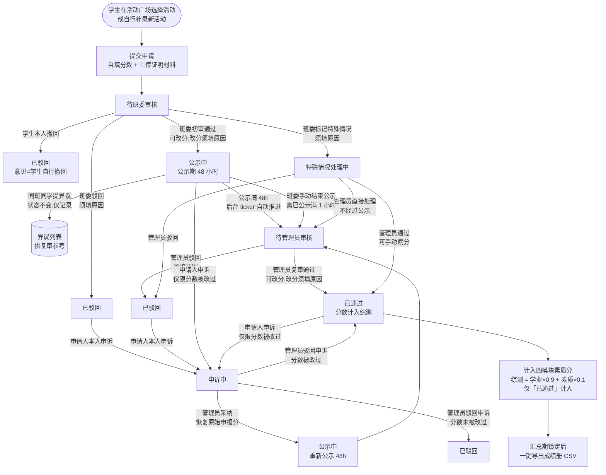
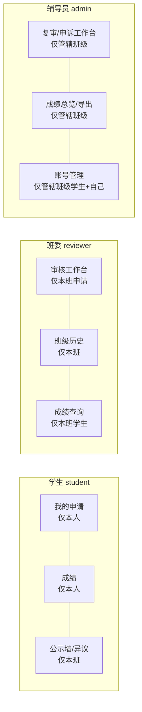

# SDU 综测系统全流程图

> 与代码实现一一对应（`internal/service/applications.go` 为状态机唯一来源）。

## 一、申请主状态机

## 二、你问的两个流程

### 1. 班委「标记特殊情况」是什么？

班委初审时遇到**无法按常规标准判断**的申请（如材料无法核验、分值难以确定、需要人工裁定），不直接通过/驳回，而是填写「特殊情况说明」后转交辅导员。

进入的流程：`待班委审核 → 特殊情况处理中 → 管理员在复审工作台直接处理`。
**注意：特殊情况跳过班级公示环节**，由管理员直接 `通过`（可手动赋分，即"一事一议"人工赋分）或 `驳回`。全程留审计日志，说明文字学生可在"我的申请"里看到。

### 2. 管理员复审如何触发？通过/驳回后发生什么？

**复审的两个触发条件**（满足其一即进入「待管理员审核」）：
1. **自动**：公示期 48 小时到期，后台 ticker 每分钟扫描自动推进（服务启动时也会执行一次）；
2. **手动**：班委在审核工作台点「结束公示并送复审」（要求已公示满 1 小时，防止秒过公示）。

**通过之后**：状态 → `已通过`，该申请分数**立即计入**学生四模块素质分（公示中的不计入），学生"我的成绩"、班级成绩总览即时更新；汇总期开启后可导出 CSV 成绩册。

**驳回之后**：状态 → `已驳回`，学生能在"我的申请"看到驳回原因；学生可在申诉入口发起申诉 → `申诉中` → 管理员在申诉工作台裁决（采纳=恢复原始分并重新公示 48h；驳回=维持原状态）。

## 三、数据隔离规则（本次新增/强化）

- **学生之间**：`我的申请` 后端强制 `student_id = 当前登录人`，同班甚至双胞胎账号也互相不可见。
- **班委**：一切数据按 `class_name = 本人班级` 过滤；跨班操作（初审/改分）直接 403。
- **辅导员**：只看**管辖班级**（`users.managed_classes`，**只能由系统管理员指定**，辅导员无权自改）；未配置管辖班级的辅导员看不到任何班级数据（fail-closed）。
- **系统管理员**（唯一账号 `superadmin`，`is_super_admin` 标志）：不受管辖班级限制，复审/申诉/成绩/导出/账号管理覆盖全校；是唯一能分配管辖班级、任命/撤销辅导员的身份；其自身角色与管辖范围不可被接口修改。
- 活动名录是全校共享的，不受班级隔离影响。

## 四、测试账号矩阵（密码统一 `123456`）

| 班级 | 班委 | 普通学生 | 管辖辅导员 |
|------|------|----------|------------|
| 公信23 | 202300202018 巩浩 | 202300271018 金瑞开、202300271019 刘晓 | 张苗 zhangmiao |
| 公信24 | 202300241001 孙倩 | 202300241002 周宇、202300241003 吴桐 | 张苗 zhangmiao |
| 公信25 | 202300251001 郑凯 | 202300251002 冯雪、202300251003 许亮 | 王强 wangqiang |
| 公信26 | 202300261001 何静 | 202300261002 卢鑫、202300261003 高媛 | 王强 wangqiang |

系统管理员：`superadmin`（唯一最高权限，不受班级限制，负责分配管辖班级与任命辅导员）。

重新初始化账号：`go run ./cmd/seedclasses`（幂等，不覆盖已有密码，同时保障系统管理员账号存在）。
